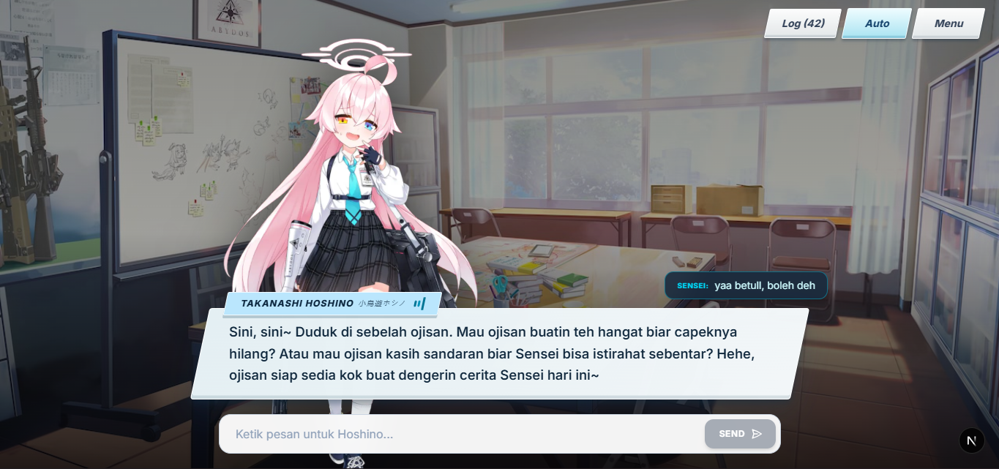

# Blue Archive Web Monorepo

Monorepo berisi dua aplikasi bertema **Blue Archive**:
1. **`apps/landing`** — Landing page interaktif Takanashi Hoshino (Vite + React + Tailwind CSS v4).
2. **`apps/chat`** — AI Waifu Visual Novel Chatbot multi-karakter (Next.js 16 + Gemini API + Fish Audio TTS).



---

## Struktur Folder

```
blue-archive-web/
├── apps/
│   ├── landing/              # Vite + React (Hoshino Landing Page)
│   │   ├── public/           # Gambar, audio (Uheee, BlueArchive theme, dll.)
│   │   └── src/              # Hero, About, Special, Gallery (3D+Pie), Music player
│   │
│   └── chat/                 # Next.js 16 (AI Waifu Chatbot)
│       ├── public/           # Sprites, scenery backgrounds, sound
│       └── src/              # Gemini chat API, Fish Audio TTS route, UI VN
│
├── package.json              # Monorepo workspaces config
└── README.md
```

---

## Menjalankan di Lokal

### 1. Install Dependencies

Di root folder:
```bash
npm install
```

### 2. Jalankan Apps

- **Landing Page (Port 5173):**
  ```bash
  npm run dev:landing
  ```
- **AI Waifu Chat (Port 3000):**
  ```bash
  npm run dev:chat
  ```

### 3. Build Semua Apps

```bash
npm run build
```
Atau per-app:
```bash
npm run build:landing
npm run build:chat
```

---

## Panduan Deploy ke Vercel

Karena berbentuk monorepo, import repo **`RakhaFR/blue-archive-web`** dua kali di dashboard Vercel menjadi 2 project:

### Project 1: Hoshino Landing Page
- **Project Name:** `hoshino-landing` (atau sesuka kamu)
- **Framework Preset:** `Vite`
- **Root Directory:** klik *Edit* -> pilih `apps/landing`
- **Build Command:** default (`vite build`)
- **Output Directory:** default (`dist`)

### Project 2: AI Waifu Chat
- **Project Name:** `ai-waifu-chat` (atau sesuka kamu)
- **Framework Preset:** `Next.js`
- **Root Directory:** klik *Edit* -> pilih `apps/chat`
- **Build Command:** default (`next build`)
- **Output Directory:** default (`.next`)

---

## Aplikasi Detail

- Dokumentasi lengkap AI Waifu Chat: lihat [`apps/chat/README.md`](apps/chat/README.md)
